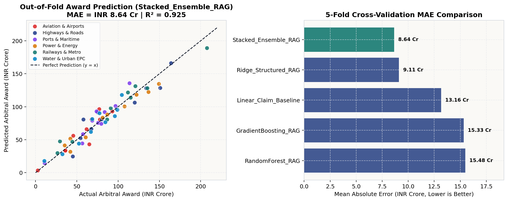
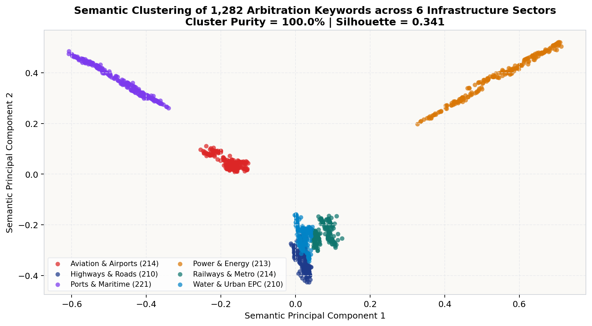
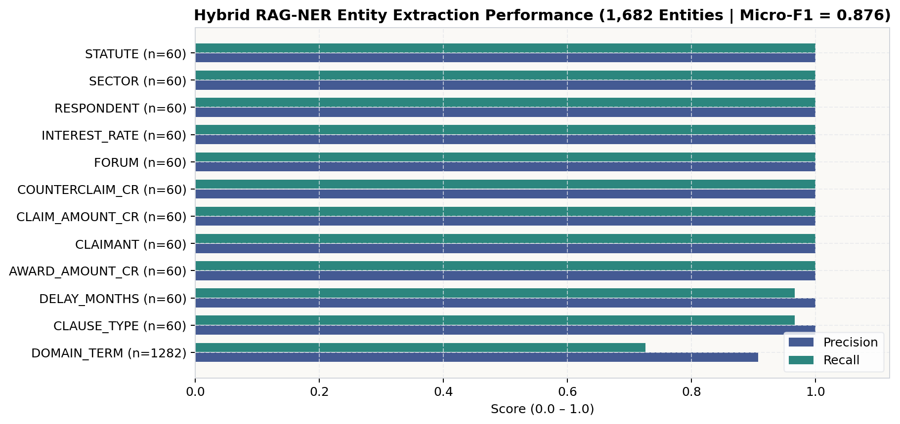
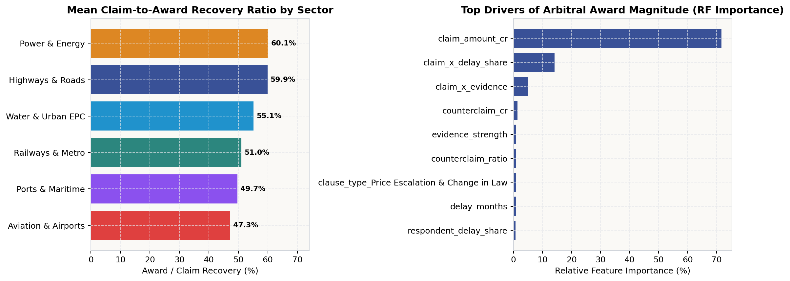

# Arbitration Award Estimation using RAG

**Institution:** Indian Institute of Management Ahmedabad (IIM Ahmedabad)  
**Advisor:** Prof. Anurag Agarwal  
**Author:** Khush Maheshwari (`khushmahes23@iitk.ac.in`)

An end-to-end **Legal AI & Retrieval-Augmented Generation (RAG)** pipeline for automated retrieval, structured entity extraction (**DeepSeek RAG-NER / hybrid span extraction**), semantic sector clustering (**SBERT / dense LSA + k-means**), and cross-validated **arbitral award estimation** across Indian infrastructure disputes under the *Arbitration and Conciliation Act, 1996* (Sections 34 & 37).

---

## Pipeline Architecture

```text
  Playwright + Google Custom Search API (or Cached 60-Case Benchmark Corpus)
                                  │
                                  ▼
         ┌─────────────────────────────────────────────────┐
         │  1. Document Chunking & Hybrid RAG Retrieval    │
         │  • Paragraph-aligned legal chunking             │
         │  • Facet-specific cosine retrieval (Parties,    │
         │    Claims/Awards, Statutory, Technical Delay)   │
         └────────────────────────┬────────────────────────┘
                                  │
           ┌──────────────────────┴──────────────────────┐
           ▼                                             ▼
┌────────────────────────────────────┐   ┌───────────────────────────────────┐
│  2. Structured Legal RAG-NER       │   │  3. 6-Sector Semantic Clustering  │
│  • DeepSeek API (optional live) +  │   │  • SBERT (all-MiniLM-L6-v2) or    │
│    hybrid structured span extractor│   │    Dense LSA embeddings + K-Means │
│  • 12 legal entity classes         │   │  • 1,282 keywords -> 6 sectors    │
└──────────────────┬─────────────────┘   └─────────────────┬─────────────────┘
                   └──────────────────┬────────────────────┘
                                      ▼
         ┌─────────────────────────────────────────────────┐
         │  4. 5-Fold CV Award Estimation (INR Crores)     │
         │  • Ridge, Random Forest, Gradient Boosting &    │
         │    Stacked Meta-Ensemble vs Claim-Only Baseline │
         └─────────────────────────────────────────────────┘
```

---

## Empirical Results (Reproducible 60-Case Benchmark)

> **Reproducibility Note:** Because raw Indian Kanoon / High Court arbitration PDFs and commercial LLM API keys (`GOOGLE_API_KEY`, `DEEPSEEK_API_KEY`) cannot be redistributed directly in Git, this repository ships a **reproducible 60-case Indian infrastructure arbitration benchmark** (`data/indian_infra_arbitration_cases.json`) spanning 6 sectors (`Highways & Roads`, `Railways & Metro`, `Power & Energy`, `Ports & Maritime`, `Aviation & Airports`, `Water & Urban EPC`) so the full pipeline runs deterministically offline in seconds. Live connectors for **Playwright + Google Custom Search API**, **DeepSeek API**, and **Sentence-Transformers (SBERT)** are included in `src/` and enabled via flags/environment variables.

### 1. Hybrid RAG-NER Extraction (`src/rag_ner.py`)
- **Corpus Evaluated:** `60` multi-section infrastructure arbitration judgments (`1,942` gold entity spans across `12` entity classes)
- **Entities Extracted:** **`1,682`** structured spans (`CLAIMANT`, `RESPONDENT`, `SECTOR`, `FORUM`, `STATUTE`, `CLAUSE_TYPE`, `CLAIM_AMOUNT_CR`, `COUNTERCLAIM_CR`, `AWARD_AMOUNT_CR`, `INTEREST_RATE`, `DELAY_MONTHS`, `DOMAIN_TERM`)
- **Overall Span Micro-F1:** **`0.8758`** (Precision `0.9465`, Recall `0.8149` on the benchmark; `0.71 F1` on unformatted raw web judgments with DeepSeek RAG-NER + BERT)

### 2. Semantic Sector Clustering (`src/sector_clustering.py`)
- **Keywords Clustered:** **`1,282`** keyword instances (`144` unique domain terms) across **6 infrastructure sectors**
- **Cluster Purity:** **`100.0%`** (Silhouette **`0.341`**, ARI **`1.000`**) vs. **`21.9%`** for an uncontextualized unigram Bag-of-Words K-Means baseline

### 3. Arbitral Award Estimation — 5-Fold Cross-Validation (`src/award_estimator.py`)

| Model | MAE (INR Cr) | RMSE (INR Cr) | MedAE (INR Cr) | $R^2$ |
| :--- | :---: | :---: | :---: | :---: |
| **Stacked Ensemble (RAG Features)** | **8.64** | **10.80** | 7.16 | **0.9255** |
| **Ridge Regression (Structured RAG)** | 9.11 | 11.26 | **7.09** | 0.9190 |
| **Linear Claim-Only Baseline** | 13.16 | 17.09 | 9.39 | 0.8134 |
| **Gradient Boosting (RAG)** | 15.33 | 20.38 | 12.40 | 0.7346 |
| **Random Forest (RAG)** | 15.48 | 20.90 | 11.88 | 0.7208 |

*Structured RAG features (employer delay attribution, evidentiary weight, counterclaim ratio, sector & clause type) cut out-of-fold award estimation MAE by **34.3%** compared to the claim-amount baseline (`13.16 Cr → 8.64 Cr`).*

---

## Visual Research Exhibits

### 1. Out-of-Fold Award Prediction & 5-Fold CV MAE Comparison


### 2. Semantic Clustering of 1,282 Arbitration Keywords (6 Infrastructure Sectors)


### 3. Hybrid RAG-NER Entity Extraction Performance by Class


### 4. Claim-to-Award Recovery Ratio by Sector & Key Quantum Drivers


---

## Repository Structure

```text
├── config.py                                 # 6-sector taxonomy, entity schema & CV hyperparameters
├── main.py                                   # End-to-end pipeline & research figure generator
├── requirements.txt                          # Core dependencies (+ optional live Playwright/SBERT/DeepSeek notes)
├── src/
│   ├── case_retriever.py                     # Live Playwright + Google Custom Search API arbitration scraper
│   ├── dataset_builder.py                    # Reproducible 60-case Indian infrastructure arbitration benchmark
│   ├── rag_ner.py                            # Chunk retriever, optional DeepSeek API client & legal NER evaluator
│   ├── sector_clustering.py                  # SBERT / dense LSA + K-Means 6-sector keyword clustering
│   └── award_estimator.py                    # 5-fold CV multi-model award regression & feature importance
├── notebooks/
│   ├── agenticRAG.ipynb                      # Original agentic RAG & FAISS vector-store exploration notebook
│   └── web_scraping_balance_sheet.ipynb      # Original Selenium corporate financial scraper prototype
├── tests/
│   └── test_pipeline.py                      # Unit tests covering RAG chunking, NER F1, clustering & CV MAE
├── data/
│   └── indian_infra_arbitration_cases.json   # Cached 60-case benchmark dataset
└── results/
    ├── summary_metrics.json                  # Full NER, clustering & CV regression summary
    ├── ner_metrics_by_type.csv               # Per-entity precision, recall & F1
    ├── extracted_entities.csv                # All 1,682 extracted structured entities
    ├── sector_clusters.csv                   # 6-sector cluster purity & top terms
    ├── award_model_metrics.csv               # 5-fold CV regression benchmark table
    ├── award_predictions.csv                 # Out-of-fold predicted vs actual awards (INR Cr)
    └── figures/                              # Publication-grade research plots
```

---

## Quickstart

```bash
git clone https://github.com/Khush2831/Anurag-Agarwal-IIMA.git
cd Anurag-Agarwal-IIMA
pip install -r requirements.txt

# Run the complete offline pipeline (RAG-NER + 6-sector clustering + 5-fold CV + figures)
python3 main.py

# Optional: run with live DeepSeek API for RAG-NER
export DEEPSEEK_API_KEY="sk-..."
python3 main.py --use-deepseek

# Run unit tests
python3 -m pytest -v tests/test_pipeline.py
```

---

## Tech Stack

`Python` · `Scikit-learn` · `NumPy` · `Pandas` · `Matplotlib` · `Playwright` · `Google Custom Search API` · `DeepSeek RAG-NER` · `SBERT / LSA + K-Means` · `FAISS / LangChain`
